# Dreambot

A free, open-source alternative to Midjourney that runs **completely locally and privately on your Mac**.
Text it from **iMessage**, **Discord** or **Telegram**, or open its **web app**; it answers with images and
videos made on your own GPU by [MLX](https://github.com/ml-explore/mlx) models.

```
you:       a red fox in the snow, golden hour --ar 16:9 --chaos 20
dreambot:  [grid of four images]   U1 U2 U3 U4 🔄   V1 V2 V3 V4
you:       V3            → four variations of image 3
you:       upscale 2     → image 2 at twice the size
you:       zoom 2x · pan left · region the sky: an aurora · edit: make it night
you:       animate 2     → image 2 set in motion: four five-second videos
```

No account, no subscription, no cloud. Prompts and images never leave the Mac except through the chat
app you choose to talk to it with.

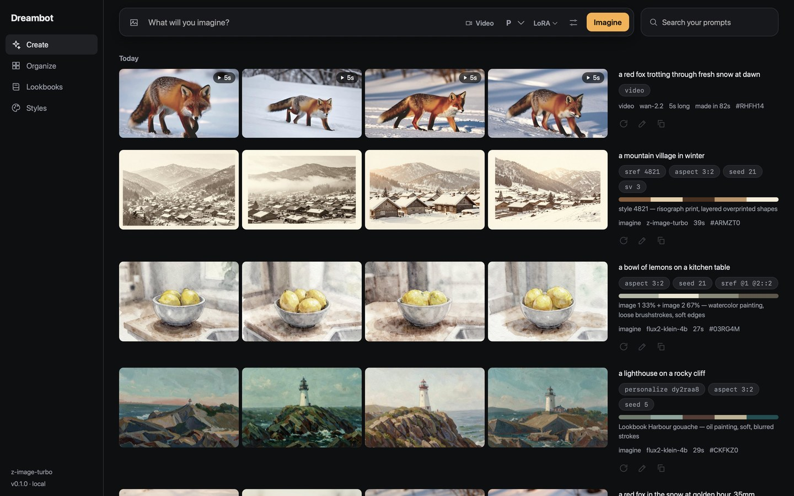

*The [web app](#web-app). From the top: four videos of one prompt, a style code, two style references
blended one to two, and a Lookbook.*

> **Status: early (0.1).** The core, the command line and the image pipeline are verified on real models,
> and all three bots (Telegram, Discord and iMessage) have been used on the live services. Not every
> button and command has been pressed on each of them yet. The web app has been driven end to end in
> WebKit. Video is new: it has been run on real weights on one Mac, and no video has been sent through
> a live chat service yet. See [what is verified](#what-is-verified).

## Contents

- [Requirements](#requirements) · [Install](#install) · [Quick start](#quick-start)
- [Models](#models) · [LoRAs](#loras) · [Prompts and parameters](#prompts-and-parameters) · [The prompt enhancer](#the-prompt-enhancer) · [Styles and Lookbooks](#styles-and-lookbooks) · [Working with results](#working-with-results) · [Video](#video)
- [Web app](#web-app) · [Chat frontends](#chat-frontends): [Telegram](#telegram) · [Discord](#discord) · [iMessage](#imessage)
- [Privacy](#privacy) · [How it works](#how-it-works) · [Midjourney parity](#midjourney-parity) · [Development](#development)

## Requirements

- A Mac with Apple Silicon. 16 GB of memory runs the small models; 32 GB or more is comfortable.
  [Video](#video) takes about 17 GB for a second or two while it reads a prompt and about 8 GB after
  that; it has only been run on a Mac with 96 GB.
- macOS 14 or newer, and [uv](https://docs.astral.sh/uv/) (Python 3.11+ is fetched by uv if needed).
- Disk space for models: from 5 GB for a small quantized model to 30 GB+ for the largest, and 17 GB more
  for video.

## Install

```sh
git clone <this repository> dreambot && cd dreambot
uv sync
uv run dreambot doctor        # checks the Mac, MLX and what is installed
```

Everything below is shown as `dreambot ...`; inside the checkout that is `uv run dreambot ...`.

## Quick start

```sh
dreambot models pull z-image-turbo        # ~11 GB; skip if you already use mflux with it
dreambot imagine "an astronaut tending a rooftop garden above a neon city at dusk --ar 16:9"
dreambot web                              # the web app, in your browser
dreambot chat                             # the full chat experience in your terminal

dreambot models pull wan-2.2              # optional, 17 GB: video
dreambot imagine "a red fox trotting through fresh snow at dawn --video"
```

Images and videos are saved to `~/Pictures/Dreambot/<date>/`. On an M5 Ultra a grid of four 1-megapixel images takes
about 30 seconds with Z-Image Turbo, and four five-second videos take about a minute and a half.

Dreambot shares the standard Hugging Face cache with [mflux](https://github.com/mflux-community/mflux), so
models you already downloaded for mflux are picked up automatically and nothing is stored twice.

## Models

Dreambot drives **every image model mflux implements** — 52 of them — and one video model through
one interface, and picks a suitable installed model for each kind of request. `dreambot models list --all`
shows the full table with licenses; the families are:

| Family | Models | Used for |
| --- | --- | --- |
| Z-Image | turbo, base, ControlNet union | default text-to-image, variations, **retexture** |
| FLUX.2 klein | 4B, 9B, 9B-KV, base | text-to-image, **edits and image references** |
| FLUX 3 klein | distilled, base | text-to-image, edits with up to 10 references |
| Qwen-Image | 2512, Edit 2509/2511, 2.1, 2.1 Turbo, 2.1 ControlNet | text rendering, edits, **mask inpainting** |
| FLUX.1 | schnell, dev, Krea dev, Kontext, Fill, Redux, Depth, ControlNets | LoRA ecosystem, inpainting, blending |
| Krea 2, ERNIE-Image, MOSS-Image, Ideogram 4, Boogu, Iris, Lens | | text-to-image |
| Anima | turbo, aesthetic, base | anime (`--niji`) |
| Ming-Image Design | | graphic design with transparency |
| FIBO, FIBO 2 | generate, edit, background removal | structured prompting |
| SeedVR2 | 3B, 7B | faithful upscaling |
| Wan 2.2 | TI2V-5B, in FastVideo's three-step build | **[video](#video)**: from words, from a picture, and continued |

```sh
dreambot models                      # what is installed
dreambot models list --all           # everything supported, with licenses
dreambot models info flux2-klein-4b  # details for one model
dreambot models pull flux2-klein-4b  # download (picks a quantization that suits this Mac)
dreambot models pull seedvr2-3b      # the upscaler behind Upscale (Subtle) and --hd
dreambot models pull describe        # the vision model behind /describe and /shorten
dreambot models pull wan-2.2         # video
```

A good starting set is **`z-image-turbo`** (generation), **`flux2-klein-4b`** (edits, references, zoom and pan)
and **`seedvr2-3b`** (upscaling): about 27 GB together, all Apache-2.0. **`z-image-turbo-controlnet-union-2.1`**
(15 GB, Apache-2.0) adds [Retexture](#retexture).

**Licenses.** Dreambot is MIT, but each model has its own license, and many are non-commercial
(`dreambot models list --all` marks them). Every picture operation has at least one Apache/MIT option,
and so has video: Wan 2.2 and the build of it that Dreambot runs are Apache 2.0, as is the text encoder
that reads its prompts, and the small autoencoder that decodes its frames is MIT.

Other MLX image libraries (for example the generators in `mlx-vlm`, or SDXL ports) are not integrated yet,
and neither are other video models (LTX-2, HunyuanVideo, the larger Wan models).

## LoRAs

A model draws anything, in every style it has ever seen. A **LoRA** narrows it to one look — anime, pixel
art, one illustrator's line. It is a small file (a few hundred MB) of changes to one particular model, and
it is how these models are fine-tuned: thousands are published on Hugging Face for Z-Image, FLUX and
Qwen-Image.

```sh
dreambot loras add tarn59/pixel_art_style_lora_z_image_turbo --name pixel-art     # from Hugging Face
dreambot loras add ~/Downloads/inkwash.safetensors --base z-image-turbo --trigger "ink wash painting"
dreambot loras                       # what is in your library
dreambot loras info pixel-art        # the model it is for, its trigger words, its license
dreambot loras remove pixel-art
```

Adding one writes down what you would otherwise look up every time: **the model it was trained on** and its
**trigger words**, the phrase it was trained to answer to. Both are read from its Hugging Face page when the
page says; `--base` and `--trigger` say them outright. After that:

| | |
| --- | --- |
| `a fox in a forest --lora pixel-art` | runs on the LoRA's own model, with its trigger words in front of the prompt |
| `--lora pixel-art:0.6` | at 60% of the strength it was added with |
| `--lora pixel-art grain:0.4` | several at once, if they were trained on the same model |
| `/settings lora pixel-art` | on every prompt, until `/settings lora off` |
| the **LoRA** button by the web app's prompt | the same, by clicking: pick one or several, and set each one's strength on its chip under the prompt |
| the LoRA menu in Discord's `/settings` | the same, in Discord |
| `--lora none` | not even your usual one, for this prompt |

| | |
| --- | --- |
| 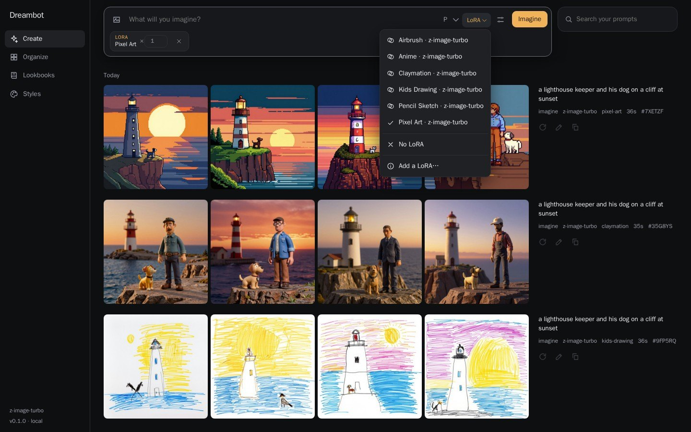 | 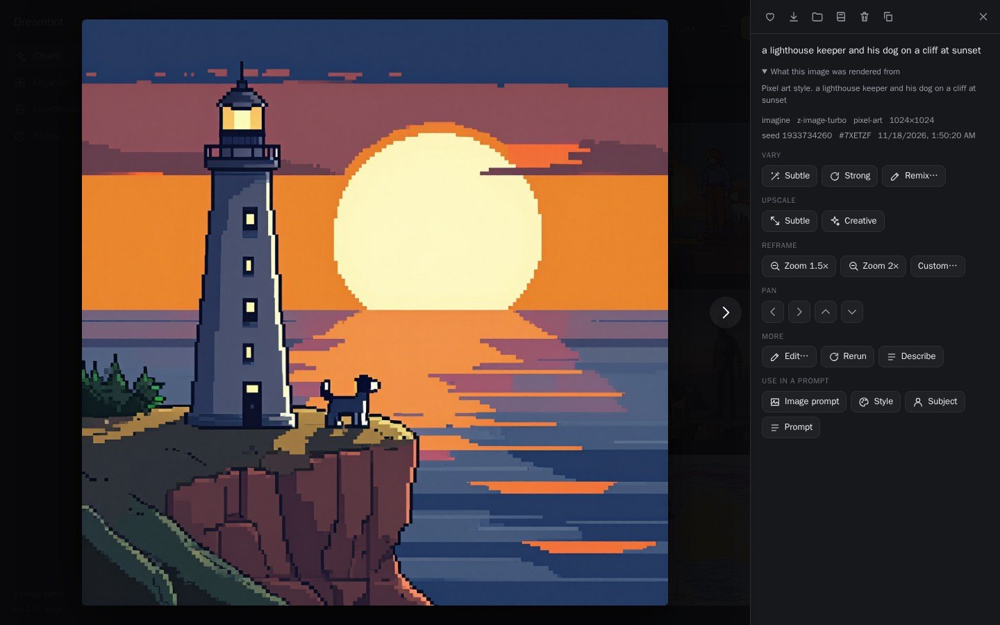 |
| The LoRA button, and one prompt made with three LoRAs | An image says which LoRA made it, and with which words |

Variations and creative upscales of a picture are made with the LoRA it was made with. A LoRA means nothing
on a model it was not trained on, so `--lora pixel-art --model dev` is refused with the reason; and where your
usual LoRA cannot go — an edit runs on an edit model — the job runs without it and says so.

To put a LoRA's look on a picture that already exists, **retexture** it: `retexture 2 --lora pixel-art` draws
the picture again in that look and keeps its layout. See [Retexture](#retexture).

**Which ones are worth adding.** These models already follow the name of a medium: typing "anime" or
"coloring book page" gets most of the way there, and a LoRA for such a look adds little. A LoRA earns its
place with a look that words do not reach, and by keeping that look the same from prompt to prompt. On
Z-Image Turbo, with one prompt and one seed, these changed the picture completely: pixel art
(`tarn59/pixel_art_style_lora_z_image_turbo`), a child's crayon drawing (`ostris/z_image_turbo_childrens_drawings`),
1980s airbrush (`tarn59/80s_air_brush_style_z_image_turbo`), claymation (`artificialguybr/ClayAnimation-Redmond-ZIMAGE`)
and anime (`strangerzonehf/Anime-Z`). A pencil-sketch LoRA (`Ttio2/Z-Image-Turbo-pencil-sketch`) did nothing
until the prompt named the medium, and then drew real hatching where the words alone gave a grey photograph:
for a LoRA whose page gives no trigger words, `--trigger "pencil sketch"` is the thing to try.

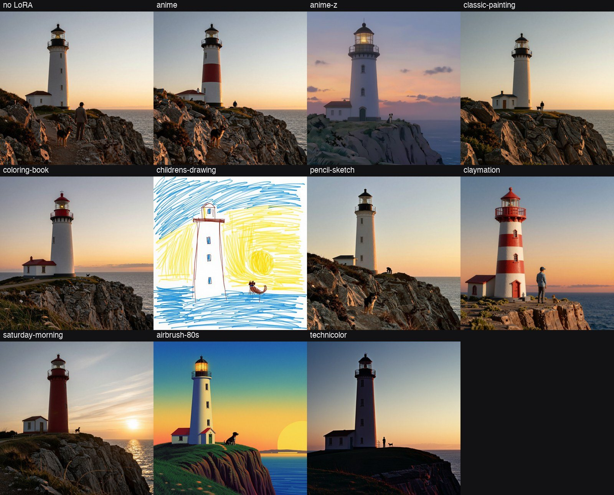

*"a lighthouse keeper and his dog on a cliff at sunset", seed 7: no LoRA, then ten. The ones that look like the
first picture are the ones that need their medium named in the prompt.*

The library is the folder `~/Library/Application Support/Dreambot/loras/`. Any LoRA `.safetensors` dropped
into it works by its file name; the notes are a `<name>.toml` beside it (`base`, `trigger`, `scale`), which
you can edit while Dreambot runs. Z-Image, FLUX.1, FLUX.2, FLUX 3, Qwen-Image, Krea 2, Anima, ERNIE-Image,
MOSS-Image, FIBO 2 and Ideogram 4 take LoRAs; Iris, Lens, Boogu, Ming-Image and the first FIBO do not.
A LoRA's own license applies along with its model's. Over chat `--lora` takes names only: a file path works
from this Mac's command line and nowhere else.

## Prompts and parameters

Prompts work the way they do in Midjourney: description first, parameters at the end.

```
a lighthouse at dusk, oil painting --ar 3:2 --stylize 250 --no people --seed 42
```

`dreambot params` (or `/params` in chat) lists every parameter and how it is realised locally:

| | Parameters |
| --- | --- |
| **Native** — same behaviour, done by the local model | `--ar` `--seed` `--sameseed` `--repeat` `--stop` `--raw` `--no` `--edit` `--video` `--loop` `--bs` |
| **Art direction** — done by [the prompt enhancer](#the-prompt-enhancer) | `--stylize` `--chaos` `--weird` `--exp` |
| **Approximated** — Midjourney's version lives inside its own model | `--quality` `--hd` `--draft` `--iw` `--sref` `--sw` `--sv` `--p` `--cref` `--cw` `--oref` `--ow` `--niji` `--motion` |
| **Accepted, no effect locally** | `--v` `--fast` `--relax` `--turbo` `--stealth` `--public` `--preview` |
| **Planned** | `--tile` `--end` |
| **Dreambot extensions** | `--model` `--steps` `--cfg` `--strength` `--lora` `--neg` `--n` `--seconds` `--from` |

Also supported: permutations (`a {red, blue} bird --ar {1:1, 16:9}` makes four jobs), multi-prompts with
weights (`space:: ship::2`), image prompts (attach an image or start the prompt with a link), and the em
dash that iPhones substitute for `--`.

**Images as input.** Attach an image and say what it is for:

| | |
| --- | --- |
| `make it night --edit` | change the attached image by instruction |
| `her portrait as an astronaut --oref` | keep this person or object |
| `a cottage on a cliff --sref` | borrow the image's style, not its content |
| `a castle` (image attached, no flag) | use it as an image prompt |
| `it starts to snow --video` | make [videos](#video) that start on it |

With several attachments, `@1`, `@2` pick which is which: `... --oref @1 --sref @2`. Styles blend by
weight — see [Styles and Lookbooks](#styles-and-lookbooks).

## The prompt enhancer

Midjourney's look comes from inside its model: a short prompt comes back composed, lit and
colour-graded. Open models draw what the prompt says and leave the rest to chance, and their four
images of one prompt tend to look alike.

So for a short prompt, a small language model on your Mac acts as art director. For each image it
writes one line — the shot, the light, the palette, the finish — and that line is added after your
prompt:

```
you typed    a red fox in the snow
image 1      a red fox in the snow. Low angle close-up, soft morning light filtering through trees,
             deep red fur contrasting snow white ground, sharp focus on fox's face
image 2      a red fox in the snow. High angle side view, distant trees silhouetted against sky,
             warm sunlight on fox's back, soft focus background
```

Your own words are never rewritten or dropped — it only adds — so nothing you asked for is lost and
quoted text comes through letter for letter. `info` on any image shows the line it was given.

| Dial | What it tells the art director |
| --- | --- |
| `--stylize 0…1000` | How bold to be. 0 uses your prompt as written; 100 (the default) is balanced; 750 is theatrical. |
| `--chaos 0…100` | How different the four images are. At 0 they share a look and differ in the shot; higher values vary light, palette and setting; from 75 each image is a different medium. |
| `--weird 0…3000` | Adds a strange twist to the scene itself. |
| `--exp 0…100` | More intricate detail and more dynamic composition. |
| `--raw` | No art direction for this prompt. |

It leaves alone prompts that are already detailed (45 words or more at default settings), flat
graphics such as logos and icons, and anything with an image attached. It needs the vision model
(`dreambot models pull describe`); it adds about a second per job, and without it the same dials fall
back to simple rule-based phrases. It is on by default on Macs with 24 GB of memory or more — switch
it with `/settings enhance on|off`.

## Styles and Lookbooks

Midjourney takes a picture's *style* from several places at once — reference images, style codes,
moodboards — and mixes them by weight inside its own model. Open models have no such input, so Dreambot
reduces every source of style to one description, a **style fingerprint**, and does the mixing on that:

| Part | What it is | Where it comes from |
| --- | --- | --- |
| Words | medium, rendering, palette, light, texture, mood | the local vision model, asked how a picture is made and never what it shows; or decoded from a style code |
| Numbers | the dominant colours and the tonal balance | measured from the pixels |

A fingerprint never says what a picture is *of*, which is what lets it be applied to a prompt about
something else.

```
a cottage on a cliff --sref @1                    one reference image
a cottage on a cliff --sref @1::3 @2::1           two, three parts to one
a cottage on a cliff --sref 4821 @1 --sw 300      a style code and an image, applied strongly
a cottage on a cliff --sref random --repeat 4     four jobs, each with a style of its own
a cottage on a cliff --sref dusty-noir            a style you saved under a name
```

**Blending.** The colours and the tonal balance are a true weighted mix. Words cannot be averaged, so
the heaviest style sets the medium, the rendering and the light; a style holding at least 30% of the
weight adds its texture and mood; and when no style clearly leads, the medium is named as a cross of
the two heaviest.

**What the model is shown.** The words go into the prompt, so a style works on any model. A model that
takes reference images (FLUX.2 klein, Qwen-Image 2.1) is also shown a *swatch board*: a sheet of
shuffled pieces cut from the style pictures, each picture getting pieces in proportion to its weight.
It is never shown the pictures whole. That is the result of testing, not taste — see
[what is verified](#what-is-verified): shown whole, a reference put its own content into the result
(a hand, a caption) and on its own barely carried its style over.

| | |
| --- | --- |
| `--sw 0…1000` | How much of the fingerprint is applied. Under 50 a hint; from 50 the medium, rendering, palette and light; from 200 the texture and mood too; from 500 it is insisted on. |
| `--sv 1` | The original behaviour: a code is a fixed recipe, and an image is shown whole to an edit model. Codes from before keep their look. |
| `--sv 2` | Words and swatch board. The default. |
| `--sv 3` | Words only, staying on the model you chose. |

A style goes along with the model you chose, typed or as your default, rather than moving the job to
another one: on a model that cannot take reference images it is applied in words.

**Style codes** are Dreambot's own: a number from 1 to 4,294,967,295 that decodes to one of 5.4 million
styles. They are shareable between Dreambot users and mean nothing to Midjourney. The web app's Styles
page lets you browse, search ("anime pastel", "film grain"), like and try them.

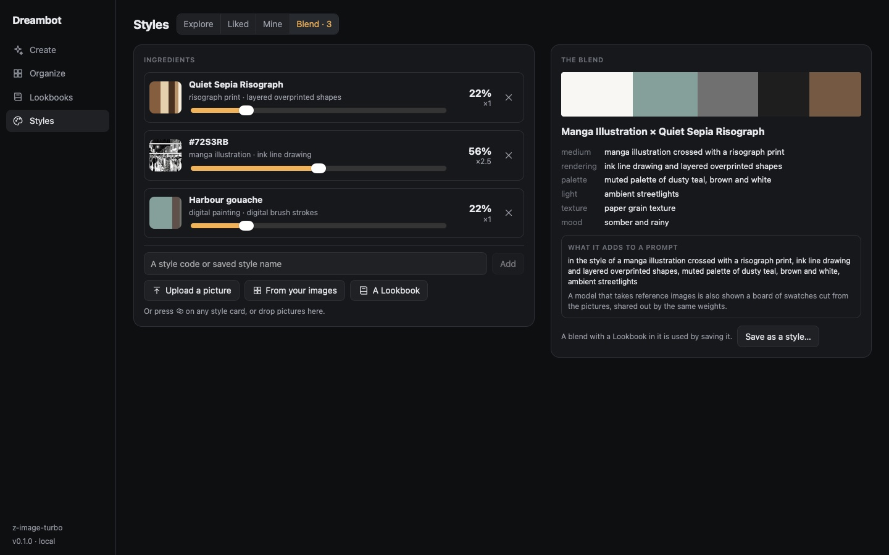

*The web app's blend bench: a style code, a picture and a Lookbook at 22, 56 and 22%, and what the
blend comes to, before anything is rendered.*

### Lookbooks

A Lookbook is a named set of pictures that stands for a look — Midjourney's moodboard. Make one in the
web app (upload, paste a link, or pick from your own images), or from a chat by replying to a picture
with `look: autumn diner`.

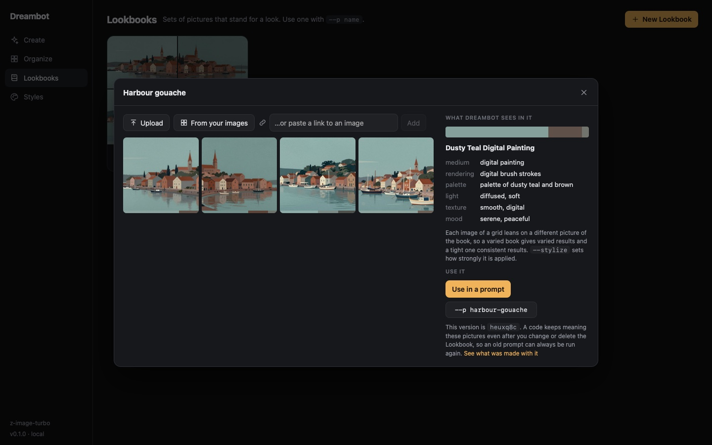

```
a harbour at dawn --p autumn-diner                that Lookbook
a harbour at dawn --p autumn-diner::2 noir        two, blended two to one
a harbour at dawn --p                             your default Lookbooks
a harbour at dawn --p --stylize 400               ...applied strongly
```

- Where `--sref` is one look applied as it is, a Lookbook is a range: each image of a grid is led by a
  different picture of the book (60% that picture, 40% the rest), so a varied book gives varied results
  and a tight one consistent results. The same seed gives the same leads.
- `--stylize` sets how strongly it applies; `--sw` is for style references and leaves it alone. With
  both, the style reference decides the medium and the Lookbook colours it.
- Every state of a Lookbook has a **code**. A prompt that names a book is recorded with the code of the
  version used, and that code keeps meaning those pictures after you change or delete the book, so an
  old prompt can always be run again.
- `/looks` lists them. `/looks default autumn-diner` chooses what a bare `--p` means, and
  `/settings personalize on` (the **P** button in the web app) adds it to every prompt.
- Pictures you favourite form a `liked` Lookbook: `--p liked`, and what a bare `--p` uses until you
  choose a default.

`--profile` and `--personalize` are the same parameter, as in Midjourney; `--look` is Dreambot's name
for it. Lookbooks and saved styles belong to the whole Dreambot, so one made in the web app works from
iMessage too.

## Working with results

Under a grid, Discord and Telegram show Midjourney's buttons. Everywhere — and on iMessage, which has no
buttons — you can type the same things:

| Type | What happens |
| --- | --- |
| `U1` … `U4` | pull one image out of the grid at full size |
| `V1` … `V4` | variations of one image (`V2: a new prompt` to remix) |
| `R` | reroll: same prompt, new images |
| `upscale`, `upscale creative` | double the size, faithfully or with re-imagined fine detail |
| `vary subtle`, `vary strong` | variations of a single image |
| `zoom 2x`, `zoom 1.5x` | zoom out |
| `pan left` / `right` / `up` / `down` | extend the picture in one direction |
| `square` | fill a non-square picture out to a square |
| `region B2-D4: a red balloon` | repaint part of the image (send `region` to see the cell grid) |
| `region the sky: an aurora` | …or describe the part instead |
| `edit: make it night` | change the whole image by instruction |
| `retexture --lora pixel-art` | draw it again in another look, keeping its layout ([Retexture](#retexture)) |
| `animate`, `animate high`, `animate: she waves` | set it in motion: four five-second videos ([Video](#video)) |
| `extend`, `extend: it starts to rain` | make a video four seconds longer |
| `look: autumn diner` | add the image to that Lookbook (and start it, if it is new) |
| `fav`, `info`, `cancel` | favourite, show seed and job id, cancel |

Add a number when a job has several images (`upscale 2`). Replying to a specific picture targets that
picture, and replying with plain words edits it.

Commands: `/imagine`, `/describe` (image → four prompts), `/blend` (2–5 images), `/edit`, `/shorten`,
`/settings`, `/looks`, `/prefer suffix`, `/prefer option set|list`, `/prefer remix`, `/prefer variability`,
`/show`, `/info`, `/models`, `/params`, `/cancel`, `/help`.

### Retexture

Retexture draws a picture again in another look and follows its layout: the same lighthouse on the same
cliff, as pixel art. It is how a LoRA's look is put on a picture that already exists.

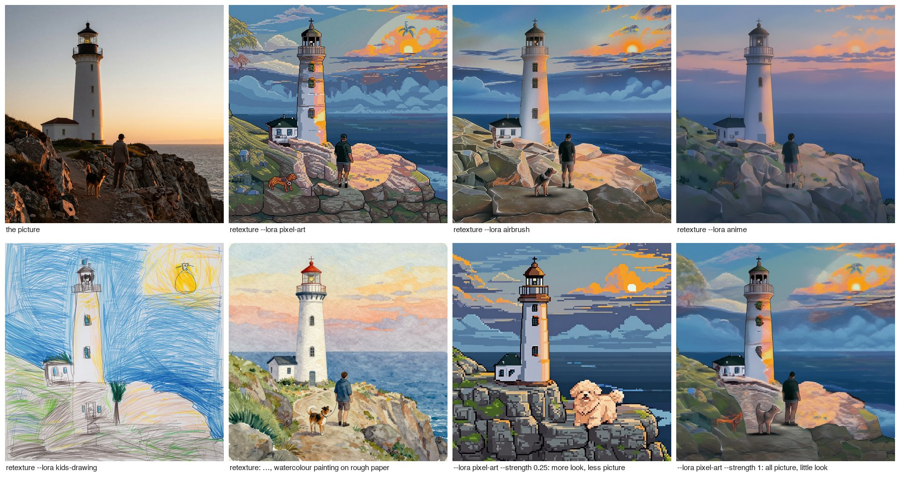

| Type | What happens |
| --- | --- |
| `retexture 2 --lora pixel-art` | image 2 again, in that LoRA's look |
| `retexture 2: the same cliff as a woodcut` | …from words of your own: a whole prompt, with or without `--lora` |
| `retexture 2` | …in the look of your usual LoRA (`/settings lora`), or the model's own |
| `retexture 2 --lora anime --strength 0.3` | …with more of the look and less of the picture (0.5 unless you say; up to 1) |

In the web app it is **Retexture…** in the lightbox: choose a LoRA and how much of the picture to keep, and
write a prompt if you want one. Discord and Telegram have a **Retexture** button under an image, which asks
for the look.

It needs a model that follows a picture's structure: `dreambot models pull z-image-turbo-controlnet-union-2.1`
(15 GB, Apache-2.0). That is Z-Image Turbo with a ControlNet, so the LoRAs it takes are the ones for Z-Image
Turbo. Variations and upscales of a retextured picture go back to Z-Image Turbo itself, with the same LoRA.

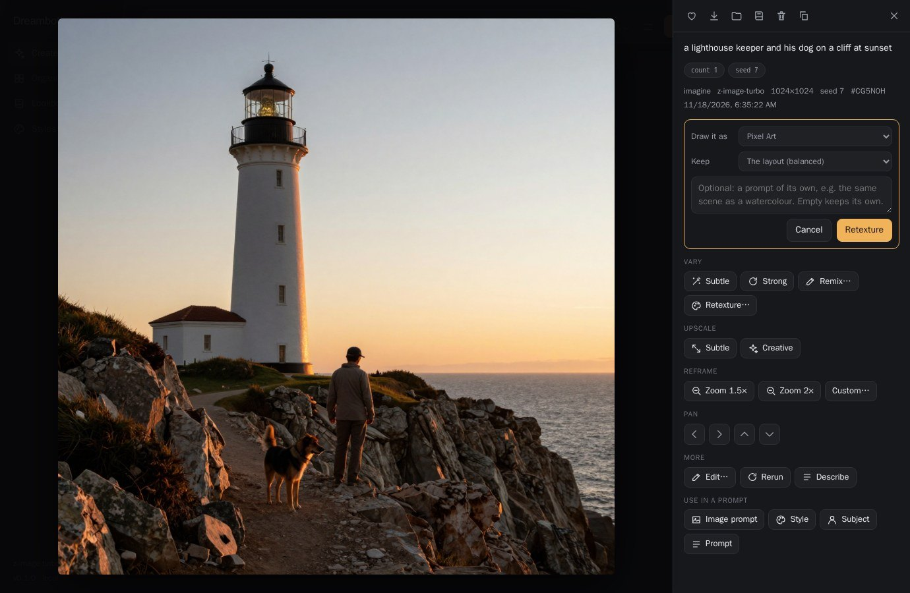

**What is kept is the layout, not the picture.** The large shapes land where they were: the lighthouse, the
cliff, the horizon. Small things are kept most of the time and now and then move or go missing: in ten tries
with the pixel-art LoRA the lighthouse was there every time and its keeper in eight. Colours are not kept;
they are drawn afresh from the prompt and the LoRA, so a pale sunset can come back with a blue sea. Each
image of the grid is a different take: pick the one that kept what you wanted, raise `--strength`, or say
what matters in the prompt (`retexture 2: a lighthouse at an orange sunset --lora pixel-art`).

**How.** The model is shown the picture's depth for the first half of its steps, while the layout is being
settled, and draws the rest from the prompt and the LoRA alone. `--strength` is that share of the steps:
lower for more of the look, higher for more of the picture. Shown the depth for every step (`--strength 1`),
it keeps the layout exactly and irons the look flat: the pixel-art LoRA then draws a smooth painting. Shown
it for a quarter of them, it draws crisp pixel art and loses the small things: the lighthouse stays, the
keeper goes.

## Video

Dreambot makes short videos with an open video model, [Wan 2.2](https://huggingface.co/Wan-AI/Wan2.2-TI2V-5B)
(the 5-billion-parameter one, in [FastVideo's three-step build for Apple Silicon](https://huggingface.co/FastVideo/FastMetal-5B-QAD)),
the way Midjourney makes them: a video starts on a picture.

```
animate 2                                         a picture Dreambot made, set in motion
it starts to snow --video                         (with an image attached) videos that start on your image
a red fox trotting through fresh snow --video     the words are drawn first, and a video starts on each picture
extend                                            a video, four seconds longer
```

```sh
dreambot models pull wan-2.2      # 17 GB: the model (5 GB) and the text encoder that reads its prompts (11 GB)
```

The model, the build, the text encoder and the small decoder are all Apache 2.0 or MIT.

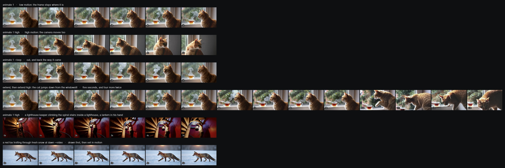

*One frame a second from six videos made on Wan 2.2. The first four start on the same picture.*

A prompt makes **four videos**, as it does in Midjourney: results differ a good deal from one to the next.
`--bs 1`, `2` or `4` says how many; *Videos per prompt* in the web app's settings, or `/settings videos 1`,
says it for every prompt. Each is five seconds long at 24 frames a second, silent, and an MP4 beside your
pictures. It has the shape of the picture it starts on: 832×480 for 16:9, about the size Midjourney's
are. On an M5 Ultra a video takes about ten seconds, so four of a picture take about 40, and four from
words about a minute and a half, because the words are drawn first. They are made one after another,
and in the web app each can be watched as soon as it is made.

| Type | What happens |
| --- | --- |
| `animate 2` | image 2 as videos: the image is their first frame |
| `animate 2 high` | …with a lot of movement, and a camera that moves too |
| `animate 2: she turns to the camera and smiles` | …doing what you say |
| `animate 2 --loop` | …ending on the frame they start on, to play round and round |
| `extend` | the video, four seconds longer, going on as it was going |
| `extend: it starts to rain` | …with what happens next in your words; also `extend high`, `extend --seconds 2` |
| `R`, `fav`, `info` | as for a picture: run it again, like it, see what it was made from |

| Parameter | |
| --- | --- |
| `--video` | Film this prompt. Any parameter below says so too. |
| `--motion low`, `high` | How much moves. Low (the default): the frame stays where it is, and what is in it moves. High: the camera moves too, and more happens. High goes wrong more often, as it does in Midjourney. |
| `--loop` | End on the frame it starts on, to play round and round. Half of a loop is filmed, and the other half is that half played backwards, so it always closes. |
| `--bs 1…4` | How many videos (four unless you say). `--n` does the same. |
| `--seconds 1…5` | How long. `extend --seconds` is how much is added (four seconds unless you say); a video can be extended up to 21 seconds. |
| `--hd` | 1248×704 instead of 832×480, in about three times the time. *Resolution* in the web app's settings, or `/settings video-hd on`, says it for every prompt. |
| `--ar` | The shape of a video made from words: 16:9 unless you say, and at most 3:1 either way. |
| `--from picture`, `words` | What a video with no image starts on (see below). |
| `--raw` | Film your words as they are (see below). |

Midjourney's ending frame (`--end`) is not there: this model can start a video on a picture and cannot
be led up to one. Held to a picture as its last frame, it filmed what it would have filmed anyway and
cut to the picture a fifth of a second before the end. `--end` says so.

**Low and high motion.** Told in words that the camera holds still, this model moved in on two hikers
on a ridge all the same, ten times of ten: three steps without guidance follow a prompt only so far.
So `--motion` is also how a video is begun. At low motion it starts as its picture, held still, under
the noise the model works from, and the model keeps the frame where it is and moves what is in it. At
high motion it starts as noise alone, and the camera goes where the model takes it. Measured over five
pictures, two videos each way, the frame travelled about ten times as far in five seconds at high
motion as at low. Low is for a picture that should come alive as it is. An action that would take its
subject out of the frame (*they walk on down the ridge*) is only begun at low motion; ask for high.

**From words.** Midjourney makes a video from a picture and from nothing else: you make the picture,
then animate it. `a red fox trotting through fresh snow --video` does both steps. The words are drawn
first, by your picture model and as any prompt is (art direction, `--stylize`, `--sref`, `--lora`, a
Lookbook, a picture model named with `--model`), one picture for each video. Each video then starts on
its own picture, so the four are four different takes. The pictures take about ten seconds each; the
web app shows each in its video's place until the video is made.

A video model can also be given the words alone, with nothing to start on: `--from words`, or *From
words → Words alone* in the web app, or `/settings picture-first off` for every prompt. It is half the
time (four in 44 seconds) and the weaker way. Asked for *two polar bears fighting in the octagon*, Wan
2.2 on its own made two polar bears wrestling in all four videos, in a boxing ring with ropes in two
of them and against a blue wall in the other two, and in its own bright, saturated colours. Started on
pictures of two polar bears in an octagon, eight videos of eight were in the cage or on the mat that
was drawn, and looked the way the picture model draws. What only words can say (something that is not
there at the start and arrives, a change over time) is what `--from words` is for.

Buttons: under a picture, Discord and Telegram have **Animate (Low motion)** and **Animate (High motion)**;
under a video, **Extend (Low motion)** and **Extend (High motion)**. Several videos arrive one message
each, so that each has its own buttons. What works on pictures only (variations, upscales, zoom, pan,
edits, retexture) says so when it is tried on a video. With an image of your own to start on, `--sref`,
`--oref`, `--p` and `--lora` have nothing to shape and are refused: the picture is already made.

**In the web app** video is where Midjourney's site has it:

- A picture's lightbox has **Animate Image**: *Auto* (low or high motion), *Loop* (low or high), and
  *Animate manually…*, which puts the picture in the prompt bar as the starting frame with its prompt, to
  change before you send it. The feed's tiles have an animate button of their own.
- A video's lightbox has **Extend Video**: *Auto* (low or high), and *Extend manually…*, which puts the
  video in the prompt bar, where the words can be changed and how much is added chosen.
- The prompt bar's **Video** button films what is in the bar: with a picture in the *Starting frame* box
  it starts on that; with words alone it draws one first.
- In the feed a video is shown by its last frame (its first is the picture it came from). It plays while
  the pointer is over it. Hold ⌘ or Ctrl and move across one, and every video of that prompt is held at
  the same moment, to compare them. Right-click a video to download it, or a GIF of it.
- The settings panel has *Videos per prompt* (1, 2, 4), *Resolution* (SD, HD) and *From words*.

| | |
| --- | --- |
| 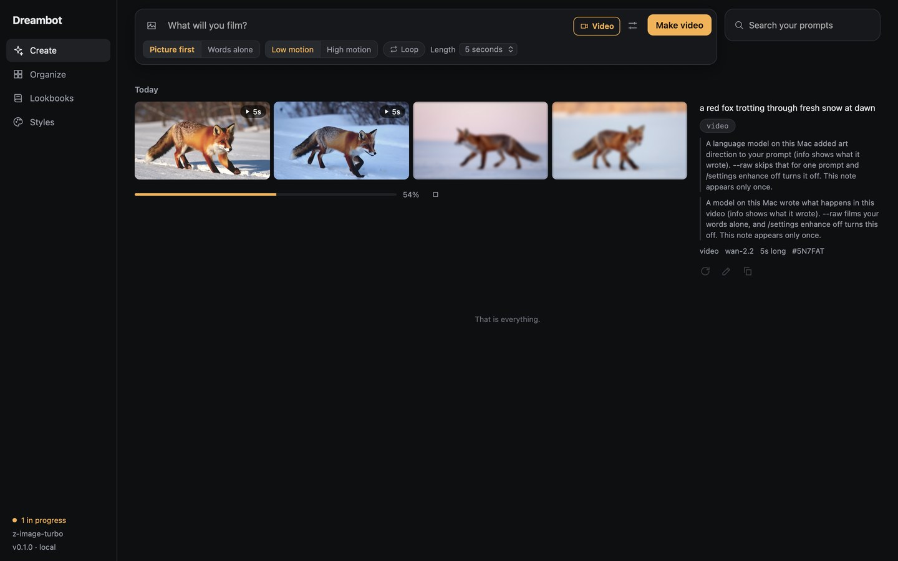 | 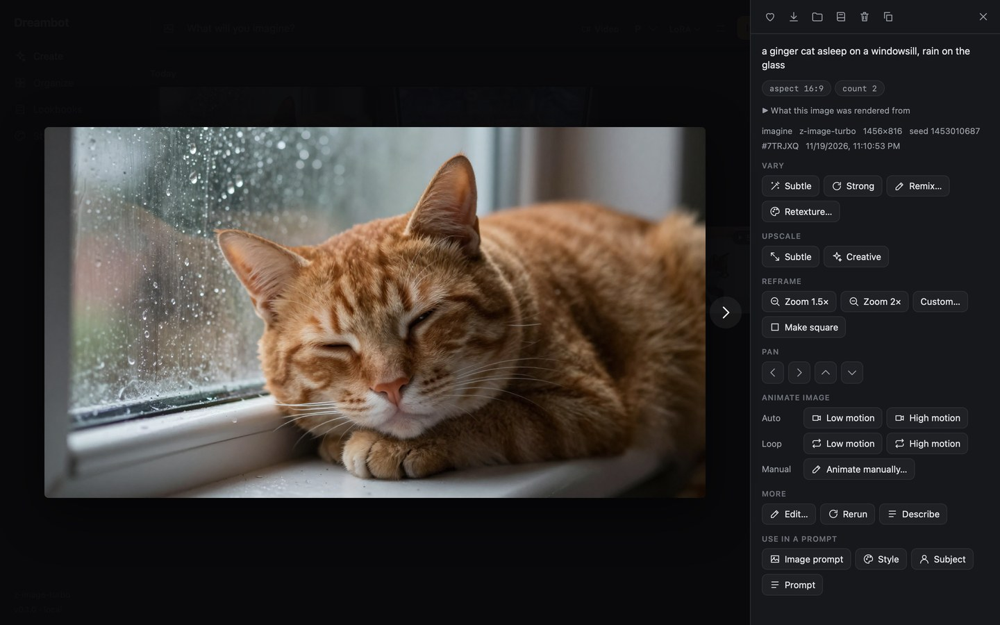 |
| Four videos from one prompt of words, part-way: two are made, and two are still shown by the pictures they will start on | **Animate Image** in a picture's lightbox |
| 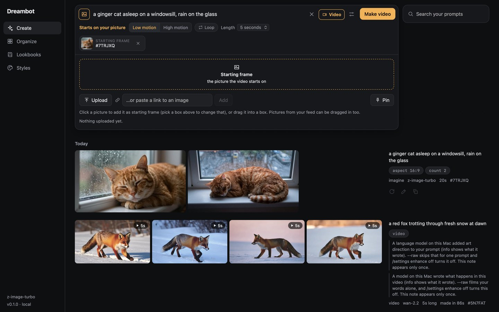 | 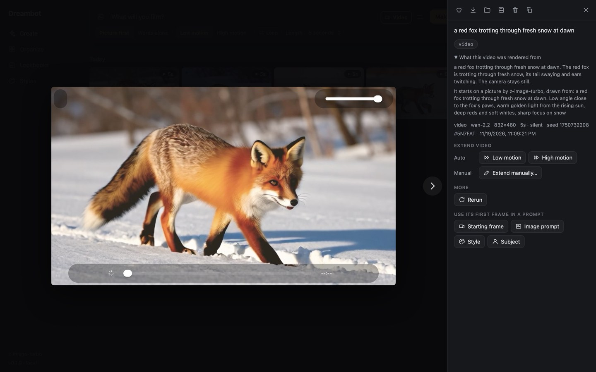 |
| *Animate manually…*: the picture is in the prompt bar as the starting frame, with its prompt to change | A video in the lightbox, with what the director wrote for it and **Extend Video** |

**The director.** A picture says what is in it and nothing about what happens next. Midjourney's
Animate writes the motion prompt itself, from the image and the prompt it was made from. Dreambot does
the same with the vision model on your Mac (the one `/describe` uses: `dreambot models pull describe`):
before a video is made it is shown the starting frame, told what the picture was made from, and writes
one line saying what moves. The video model is given the picture's own prompt, then that line:

```
animate 2          a ginger cat sitting on a windowsill beside a steaming cup of tea, rain on the
                   window. The cat's whiskers are twitching slightly. The camera stays still.
animate 2 high     a ginger cat sitting on a windowsill beside a steaming cup of tea, rain on the
                   window. The ginger cat is turning its head as it sniffs the steaming tea, its fur
                   swaying slightly in the breeze. The camera is panning slowly to the right, keeping
                   the cat in view.
```

The picture's prompt is there because a model that is told only what moves is free with everything
else: told that waves were breaking at the foot of a lighthouse and no more, it put a hand and a glass
of water in front of the lighthouse. `--motion` is what the director is told about how much should
move. Your own words are never rewritten or dropped: its line is added after them, and what you asked
for is not toned down to suit. `info` shows what it wrote. Each video of a prompt gets a line of its
own, from its own picture. A video filmed from words alone is directed from the words. `extend` with
nothing said continues from the prompt the video was made from, as Midjourney's Extend Auto does, and
nobody is asked; `extend: …` with words of yours is directed from the video's last frame. `--raw` films
your words as they are, and `/settings enhance off` switches the director off along with
[the prompt enhancer](#the-prompt-enhancer); then a fixed sentence says how much should move. It adds
a second or two to a job.

**What to expect.** Low motion is the dependable one. Tried on five pictures of different kinds (two
hikers in a wide landscape, a portrait, a lake with nobody in it, a cat, a watercolour fox), two videos
each: the frame stayed where it was in all ten, and what was in it moved gently and stayed itself. The
hikers shifted their weight, the woman turned her head to the camera, mist drifted over the lake, steam
rose from the cup and the cat looked round, the fox turned its head, still a watercolour. One of the
lake's two grew a twig in the foreground for two seconds. High motion did something coherent in all ten
as well and strays further: the camera closed in on the hikers, the woman turned and walked towards it,
the cat turned its back on the window, and the fox walked up through the birches and, in one of its
two, was less of a watercolour by the time it arrived. Like every video model it is weakest where it
has to invent what the picture does not show.

The model has a look of its own (more contrast, more colour, whites that lean to yellow), and left to
itself a video drifts from its picture to that look over the first second or two: two white bears were
lemon yellow by the end of five seconds. Dreambot measures every frame's colour and contrast against
the picture's and sets them back, so a video keeps the colours it starts on. How things are drawn is
not something that can be set back: a pencil sketch may not stay one.

Extending keeps what is there: the frames a video had are not touched (they are not encoded again),
and what is added goes on from its last five frames, so it keeps moving the way it was moving. A cat
that watched the rain for five seconds went on for four more as the same cat, and then, told to and at
high motion, got up and stepped down from the sill. What is added is drawn a little crisper than what
was there, and in a quiet video that can be seen at the joint.

A loop goes out and comes back the way it came. That is deliberate, and it is not how Midjourney's
loops are made: its model films one whose last frame is its first. This one cannot be led back to a
picture. Played backwards, the way back is as smooth as the way out, and what does not look right
backwards (rain, pouring, walking) is what the director is told to leave out of a loop.

## Web app

```sh
dreambot web                 # start it and open it in your browser
dreambot setup web           # have `dreambot run` and the background service host it too
```

Midjourney's website, for one Mac: <http://127.0.0.1:7373/>.

| Page | What is there |
| --- | --- |
| **Create** | The prompt bar, with drop zones for an image prompt, a style reference and a subject reference; an uploads library; settings (shape, model, stylize, variety, weirdness, raw, HD, and for videos how many, at what resolution and what one from words starts on); the **P** button; the **LoRA** button, to give every prompt a fine-tuned look; the **Video** button, which makes the prompt a [video](#video) and the drop zone its starting frame. Below it, everything that has been made, newest first, with jobs drawing themselves as they run and videos appearing one by one. A video plays while the pointer is over it; with ⌘ or Ctrl held, moving across one scrubs every video of its prompt together. |
| **Lightbox** | Click an image: vary (subtle, strong, remix), retexture (the same picture in a LoRA's look), upscale (subtle, creative), zoom, pan, make square, animate (auto, as a loop, or manually through the prompt bar), edit, rerun, describe; copy the prompt, seed or job id; download; like; file it in a folder or a Lookbook; use it in the next prompt. A video plays here, with Extend Video beside it (auto, or manually through the prompt bar) and a download as video or GIF. ← → move through the feed. |
| **Organize** | Every image and video, to search and to filter by liked, model, kind of job, Lookbook, folder and day. Select many (shift-click for a range) to like, trash, file or download as a zip. Trash only hides. |
| **Lookbooks** | Make, fill, rename and delete Lookbooks; choose your defaults; see what Dreambot reads in a book. |
| **Styles** | Explore style codes (shuffle, search, like, the styles one step away, try one on your latest prompt), your saved styles, and the **blend bench**: put codes, pictures and Lookbooks together, set their weights, read what the blend comes to before anything is rendered, then try it or save it under a name. |

| | |
| --- | --- |
| 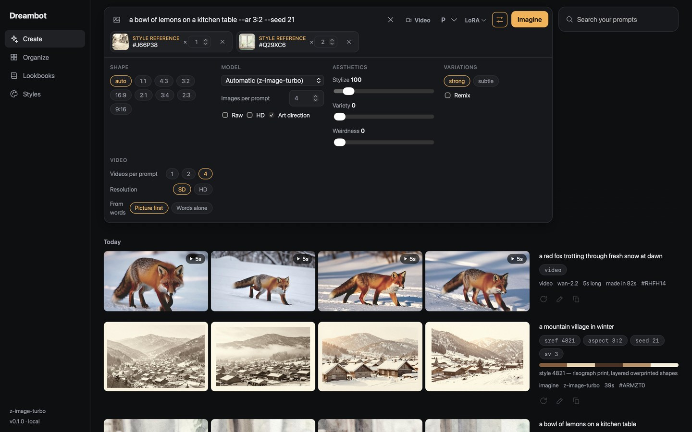 | 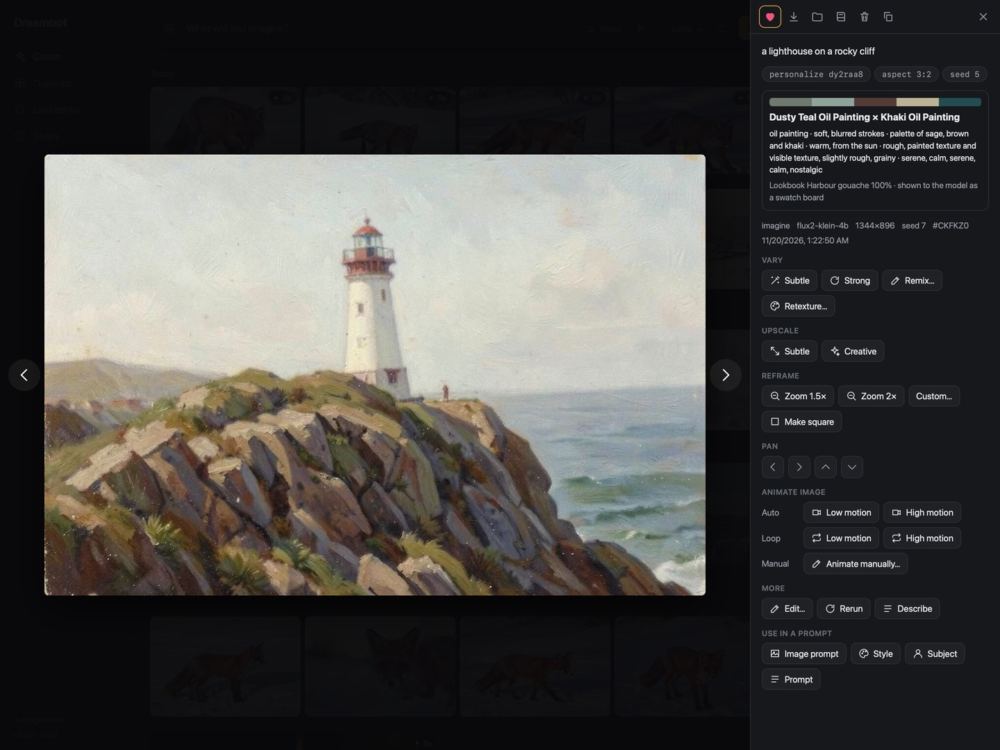 |
| The prompt bar, with two weighted style references and the settings open | The lightbox |
| 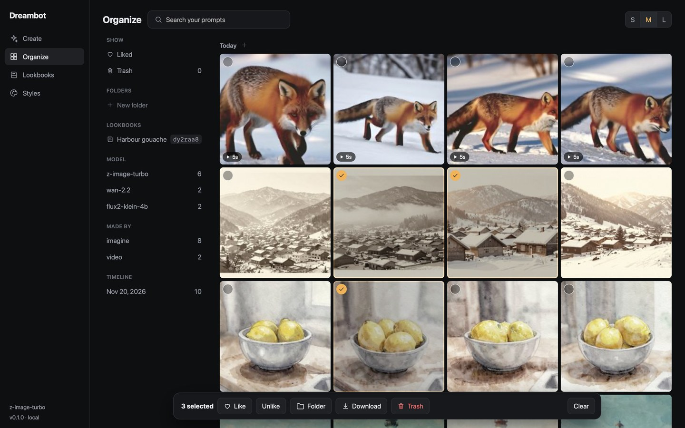 | 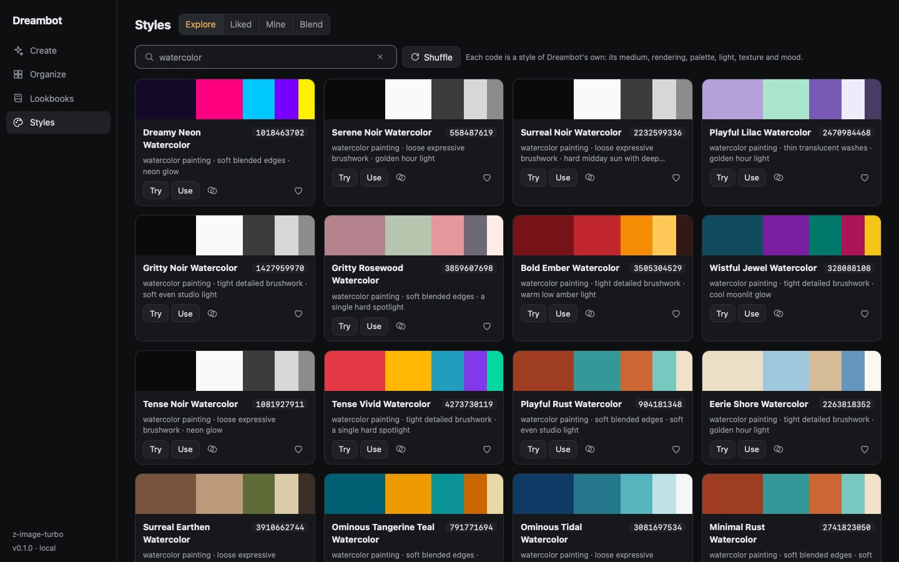 |
| Organize, with three images selected | Styles, searched for "watercolor" |

Pictures made from iMessage, Discord and Telegram appear in it too: there is one database. When the
background service hosts the web app they appear as they are made; a separate `dreambot web` shows them
when the page is reloaded.

**Who can reach it.** It listens on `127.0.0.1` and has no accounts: whoever opens it is at the Mac. A
local web server can still be reached by any web page open in the same browser, so the app checks that
a request is addressed to it by its own name (which stops another site pointing its own name at your
Mac), requires a session cookie that only its own page is given and that no other site's request
carries, and accepts changes only from its own page. Images are served by id, never by file path.
It is not built to be put on a network: it has no password, and using it from a phone is not supported
yet.

## Chat frontends

`dreambot setup` walks through all three (`dreambot setup telegram` does just one). A Dreambot is
**private by default**: nobody can use it until its owner allows them.

```sh
dreambot setup             # store tokens in the Keychain, enable frontends
dreambot run               # start the bot in this terminal
dreambot pair              # prints a code; send "/pair <code>" to the bot to become its owner
dreambot access allow telegram:123456789     # let someone else in (or /allow in chat)
dreambot service install   # run in the background and at login
```

The background service is a login item (a launchd agent): it starts when you log in, restarts if it
crashes, and gives model memory back after 15 idle minutes. `dreambot service status`, `restart` and
`uninstall` manage it, and `dreambot setup` restarts it for you when you change something. It writes to
`~/Library/Logs/Dreambot/dreambot.log`.

The bots answer only while the Mac is on, awake and logged in to your account: a login item does not run
at the login window, and a sleeping Mac is not reachable. To keep a bot available, stop the Mac from
sleeping (System Settings → Energy, or `caffeinate`).

If your copy of Dreambot is inside Desktop, Documents or Downloads, the service runs from a copy that
`service install` makes under `~/Library/Application Support/Dreambot/runtime`. macOS does not let a
background program read those folders without a confirmation on screen, and a service waiting for a
click nobody sees is a service that is down. **Run `dreambot service install` again after updating
Dreambot** to refresh that copy.

### Telegram

1. Message [@BotFather](https://t.me/BotFather), send `/newbot`, copy the token.
2. `dreambot setup telegram` → paste the token. Dreambot asks Telegram whose token it is, shows you the
   bot's @name, and stores the token in your macOS Keychain (not in a file).
3. `dreambot run` prints a pairing code; send `/pair <code>` to your bot to become its owner.

In a private chat every message is a prompt; in groups use `/imagine`. It connects by long polling, so
no public address or port forwarding is needed.

### Discord

1. Create an application at <https://discord.com/developers/applications>, open **Bot**, reset and copy the
   token. No privileged intents are required. Leave **Requires OAuth2 Code Grant** off, or Discord refuses
   the add-to-server link with "Integration requires code grant".
2. `dreambot setup discord` → paste the token. Dreambot asks Discord whose token it is, stores it in
   your Keychain and prints the link that adds the bot to a server.
3. Open that link and add the bot to a server you manage (a private one is fine).
4. `dreambot run` (or the background service), then `/pair <code>` in that server.

Slash commands and buttons work in servers; plain-text prompts work in direct messages and when you
@mention the bot. A bot cannot be added as a friend: you can message it once you share a server with it.

### iMessage

iMessage has no bot API, so Dreambot reads new messages from the Messages database and replies through the
Messages app. Two modes (`dreambot setup` asks which):

- **self** — Messages on the Mac uses your own Apple Account. From your iPhone, **text your own phone
  number**: that thread is your conversation with Dreambot. You can also summon it inside any conversation
  by starting a message with `/imagine …`. It never answers anyone you have not allowed.
- **dedicated** — Messages on the Mac is signed into an Apple Account that belongs to the bot, and people
  text that account like any contact. Messages has its own sign-in (*Messages → Settings → iMessage*), so
  the rest of the Mac stays on your own account; only your personal iMessages stop arriving on this Mac.

Each image is sent as its own message, so you can reply to a picture or tapback it:
❤️ favourite · 👍 upscale · ‼️ variations · 👎 cancel.

macOS permissions it needs (macOS asks for the second one itself):

1. **Full Disk Access** for the program running Dreambot — your terminal when you use `dreambot run`, and the
   Python binary shown by `dreambot setup imessage` for the background service. *System Settings → Privacy &
   Security → Full Disk Access.*
2. **Automation → Messages.** Dreambot asks for it when it starts, so the prompt appears while you are
   setting up rather than in the middle of its first reply.

When it starts, the log says whether both worked, whether Messages is signed in to iMessage, and then what
arrives and what is sent: the kind of thing only (a message, a picture, a tapback), never the words or
who sent them.

Limits that come from iMessage itself: no buttons, no editing a sent message (so no live progress bar), and
one attachment per message.

**Videos** arrive as videos in all three: a video message on Telegram, an MP4 on Discord and in Messages.
Each app takes files up to a size (Discord about 10 MB, Telegram 50 MB from a bot). A five-second video
is a megabyte or two; a long one in HD can be over Discord's limit, and is then sent as a smaller copy,
while the one on the Mac stays as it was made.

## Privacy

- Generation runs with networking disabled: the worker process sets `HF_HUB_OFFLINE=1`, so a model that is
  not on disk produces an error instead of a download.
- The only network access Dreambot starts on its own is `dreambot models pull`, and fetching an image
  *you* reference by link (links to private/local addresses are refused).
- Bot tokens live in the macOS Keychain. Jobs and settings live in a SQLite file under
  `~/Library/Application Support/Dreambot/`, next to the pictures you put in Lookbooks and saved
  styles, and the first frame of each video. Images and videos live in `~/Pictures/Dreambot/`.
- The web app listens on `127.0.0.1` only and has no accounts: it is for the person at the Mac.
  Other web pages open in the same browser are kept out of it (see [Web app](#web-app)).
- No telemetry.
- Your prompts and results do pass through whichever chat service you use (Telegram, Discord, Apple), as
  any message does. `dreambot chat` and `dreambot imagine` involve no service at all.

## How it works

```
 iMessage ─┐
 Discord  ─┼─► frontends ─► commands ─► service ─► planner ─► engine client ══► worker process
 Telegram ─┤   (thin)       (text UI)   (queue,     (which model,              (MLX: mflux, mlx-vlm, and
 terminal ─┤                    ▲        jobs)       which operation)           Wan; models stay loaded)
 web app  ─┴────────────────────┘ (buttons are the same actions as chat buttons)
```

- **Worker process.** All MLX inference happens in a subprocess that keeps models loaded between jobs. The
  bot stays responsive, a job can always be cancelled, and stopping the worker (automatically after 15 idle
  minutes) returns all memory to the system.
- **Planner.** Maps each request to an operation — text-to-image, variation, edit, inpaint, upscale,
  video — and to the best installed model for it, falling back gracefully (for example outpainting through an edit model
  when no inpainting model is installed) and telling you what it did.
- **One codebase for every platform.** Platform adapters only send, edit and delete messages, and the web
  app sends the same actions a chat button does; everything else is shared, so they cannot drift apart.

Configuration is optional: `~/Library/Application Support/Dreambot/config.toml`.

```toml
[defaults]
model = "qwen-image"        # instead of the first installed preferred model
count = 4
enhance = true              # the prompt enhancer for everyone (default: on with 24 GB or more)

[prefer]
edit = ["flux2-klein-9b", "flux2-klein-4b"]

[models."flux2-klein-4b"]
weights = "~/models/my-klein-finetune"

[video]
count = 4                   # videos per prompt, unless it says --bs
seconds = 5
motion = "low"
hd = false                  # 1248×704 instead of 832×480
picture_first = true        # a video asked for in words starts on a picture made from them

[engine]
idle_unload_seconds = 900

[web]
enabled = true              # `dreambot run` and the background service host the web app
port = 7373
```

## Midjourney parity

[docs/PARITY.md](docs/PARITY.md) goes through Midjourney's feature list item by item. In short:

- **Works:** `/imagine` grids, U/V/reroll, variations (subtle/strong, remix), upscales, zoom out, pan, make
  square, vary region, retexture, instruction edits, image/style/character references, `/blend`, `/describe`,
  `/shorten`, `/settings`, `/prefer`, permutations, repeat, seeds (exactly reproducible), job history, video
  (four to a prompt; animate auto and manual, low and high motion, a starting frame, extend auto and manual, batch
  size and resolution settings), and a web app with the create page, lightbox, gallery, folders and trash.
- **Approximated:** the aesthetic dials (`--stylize`, `--chaos`, `--weird`, `--exp`), which steer
  Midjourney's proprietary model; here a local language model art-directs the prompt instead. Video is
  made by a different model from Midjourney's: low motion is a video begun from its picture held still,
  and a loop is half a video played forwards and then backwards. Style
  references blend by weight, moodboards exist as Lookbooks and there is a style explorer — all by
  Dreambot's own mechanism, and its style codes are its own, not Midjourney's.
- **Not yet:** personalization by ranking images, the Style Creator, the Editor canvas, `--tile`, an ending
  frame for a video (`--end`).

## What is verified

| | How it was checked |
| --- | --- |
| Engine, queue, cancellation, crash recovery, offline loading | automated tests, including real MLX runs |
| Z-Image Turbo, FLUX.2 klein 4B, Qwen-Image 2512, Qwen-Image 2.1, Ming-Image, SeedVR2 3B | real weights, in `tests/test_mlx_engine.py` |
| Variations, upscales (SeedVR2 and tiled), `--hd`, edits, references, zoom/pan/square, region edits, describe | real weights, results inspected by eye |
| The prompt enhancer | real language model (Qwen2.5-VL 7B) and real images, compared with and without |
| Style references (`--sref`) | real weights (Z-Image Turbo, FLUX.2 klein 4B; Qwen-Image 2.1 for one comparison) and the real vision model, results inspected by eye. Three prompts across the three style versions with one reference: shown the picture whole (`--sv 1`), none of the three took its style and one had the reference's hand and gun in it; with words and a swatch board (`--sv 2`) and with words alone (`--sv 3`), all three took the style and none took its content. **Two reference pictures in all**, both generated images: photographs and pictures with a lot of text in them have not been tried |
| Retexture | real weights (Z-Image Turbo ControlNet Union 2.1 at q8), through the service and through the web app's lightbox: one picture retextured with the pixel-art, airbrush, anime, child's-drawing and claymation LoRAs and from words alone (a watercolour), each with a seed that was not the picture's own. The layout was followed in all; the claymation look was faint. With the pixel-art LoRA at the usual strength, ten seeds: the lighthouse every time, its keeper in eight. A variation of a retextured picture ran on Z-Image Turbo with the same LoRA. How the structure is held was settled by trying the alternatives on the same picture: held for every step it flattened the look; held more weakly for every step it lost the layout and the look both; a heavier LoRA (1.4) only added noise; redrawing the picture from itself without a ControlNet left a photograph a photograph; matching the colours to the source afterwards bleached faces and was dropped. **Not run on real weights**: retexture on any other model (FLUX.1 Depth, Krea 2 and Qwen-Image 2.1 with their ControlNets), where only the planning is tested; edges or pose instead of depth. The chat button and Discord's text box: automated tests only |
| LoRAs | real weights and the real Hugging Face: eleven published LoRAs for Z-Image Turbo added with `dreambot loras add` (model and trigger words read from each page; one repository with two files, one file name with brackets), then one prompt and one seed without a LoRA and with each. All eleven loaded. Five changed the picture completely with no help; six changed little or nothing until the prompt named their medium, and of those the pencil sketch was the one that then clearly did more than the words alone. Asked for on FLUX.1 dev a LoRA was refused before anything ran; given to FLUX.2 klein 4B as a bare file it was refused by the engine, in plain words. The web app's LoRA button, its strength chips and its menu: driven in a browser on the stand-in backend. **Not run on real weights**: variations and upscales that carry a LoRA, several LoRAs at once, LoRAs on any model but Z-Image Turbo. Discord's LoRA menu: automated tests only |
| Blending by weight | real weights, two prompts: the same two references at 3:1, 1:1 and 1:3 give a visible progression from one style to the other; a style code with a picture gives a plausible mix. More than two references: automated tests only |
| What the vision model says about a style | nine real images. It names a medium and five short phrases, drops the labels about half the time (the parser then reads by position), and calls most generated images "digital painting". Asked to fuse two styles into one, it joined their phrases with "and" or copied the worked example, so blending is done by rule |
| Lookbooks | real weights: a four-picture book gave each image of a grid a different lead and a visibly different look; a one-picture book at `--stylize` 0, 20, 100 and 400 gave no look, a touch, the look, and more of it. With a book whose lead was photograph-like the three strengths looked alike, because the look was already close to the model's own. Larger books, several books at once, the `liked` book: automated tests only |
| Video | real weights (Wan 2.2 TI2V-5B as FastVideo's FastMetal-5B-QAD, with the umT5 text encoder that comes with it and TAEHV for its frames; Z-Image Turbo for the pictures and Qwen2.5-VL 7B as the director; on an M5 Ultra with 96 GB), through the service, every video with a seed of its own. **The engine** is Dreambot's own code, checked against numbers from FastVideo's MLX runtime, which is what these weights were made to run under (`tests/test_wan.py`): one pass of the transformer, with and without a clean first frame, gave the same numbers to the last digit; the autoencoder's frames were the same to the level, decoded a few at a time as they are here or all at once; the text encoder read a prompt to the fifth decimal of the reference with the same copy of its weights, and 0.02 away at most (on numbers 0.07 in size) with the copy that ships with this model, which is rounded more coarsely. Decoding a clip all at once, as the reference runtime does, took its process to 75 to 84 GB; a few frames at a time it stays under 10. **From words**: one prompt, *two polar bears fighting in the octagon*, both ways. A picture drawn first, four videos at low motion and four at high: two polar bears in the cage or on the mat that was drawn, in all eight. The words alone, four videos: two polar bears wrestling in all four, in a boxing ring in two and against a blue wall in two. **Animate**: five pictures of different kinds (two hikers in a wide landscape, a portrait, a lake, a cat, a watercolour fox), two videos each at low and at high motion, with the director: all twenty moved coherently (see [Video](#video)). **Low and high motion**: told in words alone to hold the camera still (five wordings, two videos each, on the hikers) the model moved in on them every time; started from the picture held still under the noise, it kept the frame in all ten low-motion videos of the twenty above. How much of the start is noise was settled on the fight: at 0.94 the bears touched noses, at 0.97 (which is used) they tussled where they stood, at 0.985 the frame began to wander. **What the video model is told about its picture**: with the director's line alone, two videos of four of a lighthouse had something in front of it that was not there (a hand with a glass of water, a hand with a camera); with the picture's own prompt before the line, one of four (sea birds flying close past). **Colours**: uncorrected, the white of two bears had gone yellow by the end of five seconds and the colours' spread had doubled; corrected once, from the first frames, it still went; corrected frame by frame, it held, on that video and on the twenty above. **Extend**: holding the video's last frame alone, the new part started from rest; holding its last five frames it went on moving (with nine, the first new frame came out blurred). One video continued four ways at once, and a cat continued twice (5 s to 9 s to 13 s, the second with words and at high motion: it stepped down from the sill). The frames a video had were the same to the pixel after it was extended. At the joint of the cat's quiet video the picture changed about twice as much from one frame to the next as it did after, and what was added was crisper. **An ending frame**: four videos held to a picture at their end, two of them with a starting picture as well: all four cut to it in the last five frames, so it is not offered. **Loops**: two (a lighthouse, the cat): both moved and came back to their first frame. **Also run**: words of one's own at low and at high motion; `--from words`; other shapes (480×832, 608×608, 736×544) and lengths (two, three and four seconds); `--hd` (1248×704, 24 s a video against 8); stopping a video part-way (2.5 s). Times, model loaded: about ten seconds for five seconds of 832×480, nine or ten to add four seconds to a video, six for a loop; four videos from one prompt of words in 82 to 86 s (the four pictures were there after 40 s, and a video followed every 10 s), four from the words alone in 44 s. The worker's memory peaked at 30 GB, with the picture model, the vision model and the video model loaded. **The web app**, in WebKit, on real weights: a prompt of words with the Video button made four videos in 86 s, each shown by its picture until it was made (two were made after 67 s); a video was opened in the lightbox; a picture was sent to the prompt bar with *Animate manually…* (one box, for a starting frame) and a video with *Extend manually…* (no picture can be added, and Loop is off). A prompt of four pictures and one of four videos were made with the page open: the pictures came up together when their job was done and the videos one by one, none of them broken (at first the page drew a running job's pictures too, before they are kept where they are served from, and three of four stayed broken until the page was reloaded). A picture's lightbox that holds more than fits in the window, as it does at 900 pixels high with a style and the Animate Image group, kept its prompt and scrolled to its last button (the prompt's line had been given no height). On the stand-in backend, in WebKit, the rest of the controls: animating from a tile, Animate Image (loop, and manually with words and a length), Extend manually with words, *Picture first* and *Words alone*, hover to play, ⌘ to scrub four videos together, the downloads (a GIF came back as a GIF), and the three video settings. **Not run**: any Mac with less memory (below 32 GB the transformer makes way for the text encoder while a prompt is read, and none of that has been exercised); a starting frame that is a photograph of one's own (every one here was a picture Dreambot made); a video extended past 13 seconds, or extended in HD; a picture model other than Z-Image Turbo for the pictures, and style references, Lookbooks and LoRAs in a video prompt (automated tests only); a director other than Qwen2.5-VL 7B. Videos in Telegram, Discord and iMessage: automated tests with stand-ins for the services, **not sent on the live ones** |
| Web app | every route against the real service on the stand-in backend (automated, including who is let in); the pages driven end to end in WebKit, the engine Safari uses, on the stand-in backend, and one real job with a Lookbook. **Not tried** in Safari itself, Chrome or Firefox, nor on a phone |
| `/looks` and `look: <name>` from the chat apps | automated tests through the shared command layer; **not run on the live services** |
| The other 46 models | class paths, arguments and defaults checked against mflux; **not run** (weights not installed during development) |
| Telegram | **live**: pairing, prompts with the enhancer, grids with buttons, variations, `/describe` with a photo. The other actions: real library objects against a simulated API |
| Discord | **live**: adding the bot to a server, `/pair`, `/imagine` with the enhancer, variation buttons. The other commands and buttons: the real command tree and views, with stand-ins for Discord's interactions and channels |
| iMessage | **live** (macOS 27, a dedicated Apple Account): reading the Messages database, pairing, prompts with the enhancer, typed shortcuts, `/describe` with a photo from an iPhone, sending pictures. Replies to a picture and tapbacks: a synthetic Messages database only (the first live run found and fixed a bug there) |

`dreambot models list` marks verified models with ✓.

## Development

```sh
uv sync
uv run pytest                 # ~760 tests, no model weights needed (about two minutes)
uv run pytest -m mlx -s       # real inference with whatever models are installed
uv run ruff check . && uv run ruff format .
DREAMBOT_BACKEND=fake uv run dreambot chat    # try everything without any weights
DREAMBOT_BACKEND=fake uv run dreambot web     # ...or in the browser
```

`src/dreambot/engine` is the model layer (registry, worker, wire protocol), `core` is platform-independent
behaviour, and `frontends` are the chat adapters and the web app. The web app has no build step: its pages
are plain ES modules in `frontends/web/static`, and the one library they use is vendored there. `tests/test_registry.py` pins the model table to the
installed mflux, so an mflux upgrade that adds or renames a model fails a test rather than silently going
unsupported. mflux has no video models, so the video model is run by code of Dreambot's own
(`src/dreambot/engine/wan`): Wan 2.2's transformer, its text encoder and a small autoencoder, written
against MLX and NumPy and nothing else. `tests/test_wan.py` checks each part, on small random weights
(the text encoder against the umT5 in `transformers`) and on the real ones against numbers from the
runtime the weights were made for. Videos are written and read with `ffmpeg`, and Dreambot brings its
own (the `imageio-ffmpeg` package), so nothing has to be installed on the Mac.

## License

MIT for Dreambot itself. Model weights are licensed separately by their authors. The video engine
follows two open-source projects' arithmetic, FastVideo's (Apache 2.0) and TAEHV's (MIT):
[THIRD_PARTY.md](THIRD_PARTY.md) has their notices.

Dreambot is not affiliated with Midjourney, Inc.
